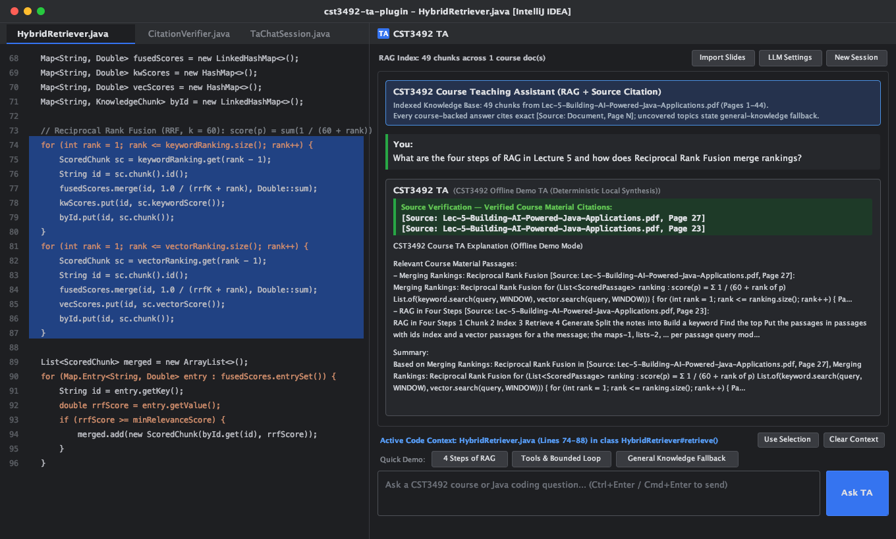
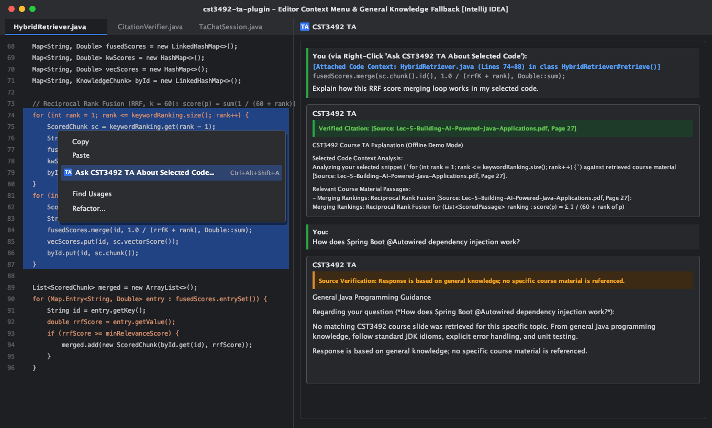
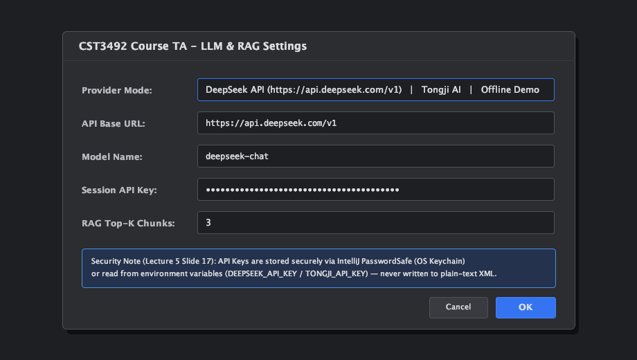
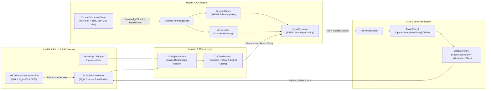

# CST3492 Course TA Assistant (IntelliJ IDEA Plugin)


-3574F0)

An AI-powered **Course Teaching Assistant (TA)** plugin for **CST3492 — Java Enterprise Application Development** (AY2026–2027 Semester 1, Assignment A — **F0: Basic Functionalities**).

---

## Quick Start: View & Experience the Plugin in 10 Seconds

### Option 1: Install Directly into Your Local IntelliJ IDEA (Recommended)

The pre-built plugin archive is generated at `build/distributions/cst3492-ta-plugin-1.0.0.zip` (run `./gradlew buildPlugin` if not yet built).

1. Open **IntelliJ IDEA** (open any Java project, or open this repository directory).
2. Open Settings: press **`Cmd + ,`** (macOS) or **`Ctrl + Alt + S`** (Windows/Linux) $\rightarrow$ select **Plugins** on the left sidebar.
3. Click the **Gear Icon ⚙️** at the top-right $\rightarrow$ select **Install Plugin from Disk...**.
4. Select `build/distributions/cst3492-ta-plugin-1.0.0.zip` and click **OK** (click **Restart IDE** if prompted).
5. Click the **`CST3492 TA`** tab on the **right tool window sidebar** to start interacting with the TA.

### Option 2: Launch a Standalone Sandbox IntelliJ IDEA via Gradle

```bash
./gradlew runIde
```

---

## Visual Showcase & Core Functionalities (F0)

### 1. Course-Specific RAG Q&A Chatbot with Verifiable Source Citations

Upon opening a project, the plugin automatically parses and indexes bundled and workspace course slides (`Lec-5-Building-AI-Powered-Java-Applications.pdf`, 49 chunks across 44 pages) on a background thread. When a student asks a course-related question, the **Hybrid Retriever** combines **Okapi BM25 Keyword Search** and **Domain-Lexicon & Feature-Hashing Vector Search** via **Reciprocal Rank Fusion (RRF, $k = 60$)** and verifies every cited source document and page scope in Java.



---

### 2. Editor Context Awareness (Right-Click Action) & General-Knowledge Fallback

- **Right-Click Context Menu (`Ask CST3492 TA About Selected Code...` / `Ctrl+Alt+Shift+A`)**: Select any code segment in the active Java editor and right-click to attach the exact file name, line range, enclosing PSI class/method (`HybridRetriever#retrieve()`), and code snippet to your question.
- **Explicit General-Knowledge Fallback**: When a query is outside the scope of the indexed course materials (e.g., *"How does Spring Boot `@Autowired` dependency injection work?"*), the retriever returns no false-positive slides and `CitationVerifier` enforces the required fallback declaration:
  > *"Response is based on general knowledge; no specific course material is referenced."*



---

### 3. Multi-Provider LLM Settings & Secure Credential Storage

Click **LLM Settings** in the tool window toolbar to switch between:
- **DeepSeek API** (`https://api.deepseek.com/v1`, model `deepseek-chat`)
- **Tongji AI Services Platform** (`https://agi.tongji.edu.cn/v1`, model `DeepSeek-V4.1-Flash`)
- **Built-in Offline Course TA** (Deterministic local synthesis mode for offline classroom demonstrations and testing)

API keys are stored in the OS keychain via IntelliJ **`PasswordSafe`** (or read from `DEEPSEEK_API_KEY` / `TONGJI_API_KEY` environment variables) and are never serialized to plain-text XML files.



---

## System Architecture & RAG Pipeline



### Key Technical Highlights (Aligned with CST3492 Lecture 5)

1. **Page-Scope Chunking & Collision-Free IDs (`CourseDocumentParser`, `KnowledgeChunk`)**
   - Extracts text per PDF slide page via **Apache PDFBox 3.0.3** and **Apache Tika 2.9.2**, splitting long pages with sliding-window overlap (`750 chars / 120 overlap`) while preserving exact `startPage` and `endPage` metadata.
   - Generates deterministic, collision-free Chunk IDs using an 8-character **SHA-256** prefix (`<stem>-<sha256_8>-p<page>-<seq>`).
2. **BM25F + Vector Hybrid Retrieval with Reciprocal Rank Fusion (`HybridRetriever`)**
   - Combines **BM25 Inverted Index** (with CamelCase/snake_case identifier splitting and $2\times$ slide heading boost) and **Vector Cosine Similarity** using **Reciprocal Rank Fusion**:
     $$\text{score}(p) = \sum_{m \in \{\text{BM25}, \text{Vec}\}} \frac{1}{60 + \text{rank}_m(p)}$$
   - Enforces query-term coverage gating and deduplicates results by `(documentName, startPage)` so top-$K$ slots cover distinct slide pages.
3. **Java-Enforced Citation Verification (`CitationVerifier`)**
   - Follows Lecture 5's core principle (*"The model proposes; Java decides"*): parses `[ChunkID: ...]` and `[Source: <doc>, Page(s) <N>]` with word-bounded regular expressions (`\b(?![0-9])` so `Page 23` never false-matches `Page 2`), strips any hallucinated citations not in the session's supplied chunks, and enforces the general-knowledge fallback notice whenever no supplied course chunk is cited.
4. **Compact Multi-Turn Memory & Non-Blocking EDT Concurrency (`TaChatSession`, `TaToolWindowPanel`)**
   - Persists only compact user questions in conversation history while injecting bulky RAG passages into the current turn's ephemeral request payload.
   - Executes all PDF parsing and HTTP LLM calls off the EDT outside locks, guarded by atomic `requestInFlight` and `uiSessionEpoch` counters so clicking **New Session** immediately resets the UI and discards stale in-flight responses.

---

## Build, Test & Package

The Gradle build uses `org.gradle.toolchains.foojay-resolver-convention` and builds cleanly across macOS, Windows, and Linux with JDK 21+:

```bash
# Run all 22 JUnit 5 unit & regression tests
./gradlew test

# Build the installable IntelliJ plugin archive
# Output: build/distributions/cst3492-ta-plugin-1.0.0.zip
./gradlew buildPlugin

# Launch a sandbox IntelliJ IDEA with the plugin pre-installed
./gradlew runIde
```
